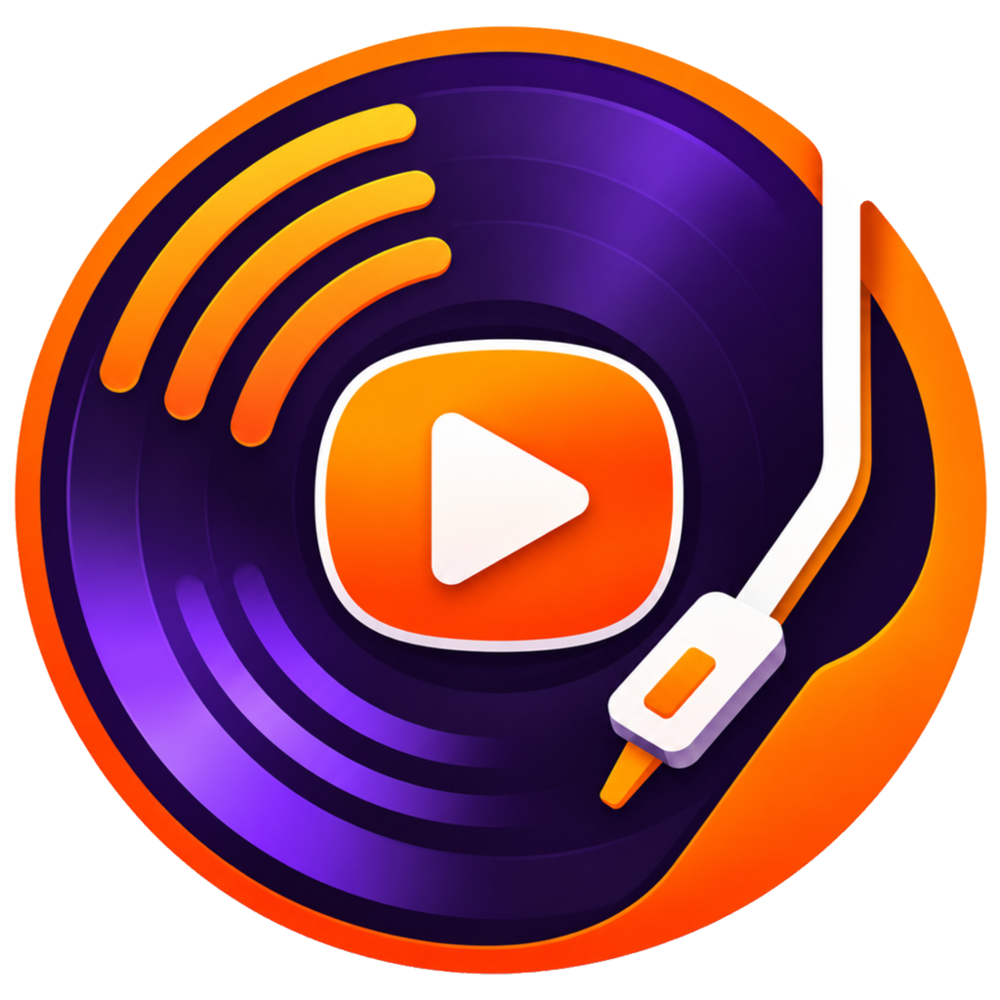

<p align="center"></p>

# DJTube

Aplicación de DJ de escritorio para Windows, sencilla y ligera, con dos platos,
crossfader, pitch con key lock, SYNC, forma de onda y pre-escucha por auriculares.

Interfaz en español e inglés (Configuración → Idioma). Cambios por versión en
[CHANGELOG.md](CHANGELOG.md).

## Requisitos

- Windows 10 2004 o superior (x64).
- SDK de .NET 10.
- Para cargar enlaces de YouTube: [yt-dlp](https://github.com/yt-dlp/yt-dlp)
  (`winget install yt-dlp.yt-dlp`, que instala también Deno y FFmpeg).

## Compilar y ejecutar

Desde la carpeta del proyecto:

```
dotnet build DJTube.slnx
dotnet test DJTube.slnx
dotnet run --project src/DJTube.App
```

## Cargar pistas

- **Enlace de YouTube:** pégalo en el campo de la pletina y pulsa Intro (o arrástralo desde
  el navegador). Se descarga solo el audio (M4A/AAC) a `%LOCALAPPDATA%\DJTube\Cache\YouTube`;
  la siguiente vez carga al instante. Si las descargas dejan de funcionar, pulsa
  «Actualizar yt-dlp»: YouTube cambia a menudo.
- **Archivo local:** botón «ARCHIVO…» o arrastrar el archivo (MP3, FLAC, WAV, AAC, M4A).

Descargar contenido de YouTube va en contra de sus condiciones de uso. Usa esta función
bajo tu responsabilidad y solo con contenido que tengas derecho a utilizar.

## Pre-escucha por auriculares

- **WASAPI** (por defecto): elige en la barra superior la «Salida» (master) y los
  «Auriculares» (otro dispositivo, p. ej. la salida de cascos de la tarjeta o unos
  auriculares USB).
- **ASIO** (Configuración → Preferencias → Modo de salida): una tarjeta de 4 canales;
  elige el par del master (p. ej. 1-2) y el de auriculares (p. ej. 3-4).

En el mezclador, el botón 🎧 de cada plato lo manda a los auriculares, independientemente de
faders y crossfader. «Mezcla auric.» va de solo los platos con 🎧 (CUE) a lo mismo que el master.

## Estructura

| Proyecto | Contenido |
|---|---|
| `src/DJTube.Core` | Modelos, interfaces y lógica pura (sin dependencias de audio) |
| `src/DJTube.Audio.Bass` | Motor de audio sobre BASS (ManagedBass) |
| `src/DJTube.Sources.Local` | Fuente de pistas: archivos locales |
| `src/DJTube.Sources.YouTube` | Fuente de pistas: enlaces de YouTube (yt-dlp + caché) |
| `src/DJTube.App` | Interfaz WPF (MVVM) |
| `tests/DJTube.Core.Tests` | Tests unitarios (xUnit) |

## Traducciones

Los textos están en archivos `.resx` (inglés como idioma neutro, español en `*.es.resx`):

- `src/DJTube.App/Resources/Strings*.resx`: interfaz.
- `src/DJTube.Core/Resources/Messages*.resx`: mensajes de error de las librerías.

## Logo e icono

El logo original está en `assets/logo-original.png`. Si cambia, se regeneran el logo transparente
y el icono con:

```
dotnet run --project tools/BrandAssets -- assets/logo-original.png assets src/DJTube.App/Assets
```

## Versión

La versión del programa está en `Directory.Build.props` (`<Version>`); al compilar se le
añade el commit de git y se muestra en «Ayuda → Acerca de DJTube».

## Licencia de BASS

`lib/native/x64` incluye las DLL de [BASS](https://www.un4seen.com) y sus complementos
(bass_fx, bassmix, basswasapi, bassasio, bassflac), propiedad de Un4seen Developments.
BASS es gratuito **solo para uso no comercial**. Si quieres usar este código en un
producto con el que se obtengan ingresos (ventas, publicidad, etc.), necesitas tu propia
licencia comercial de BASS: consulta las condiciones en www.un4seen.com.
